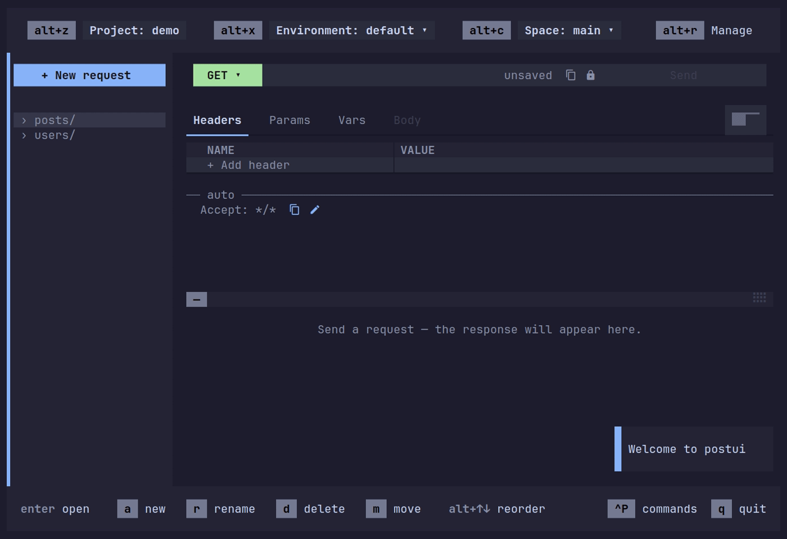
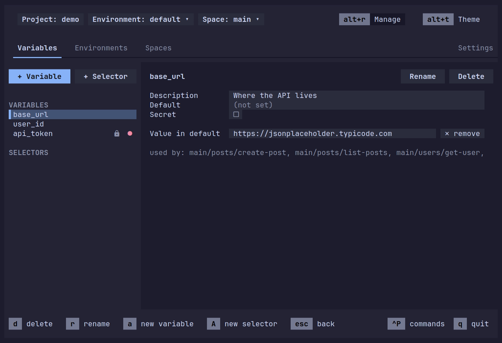
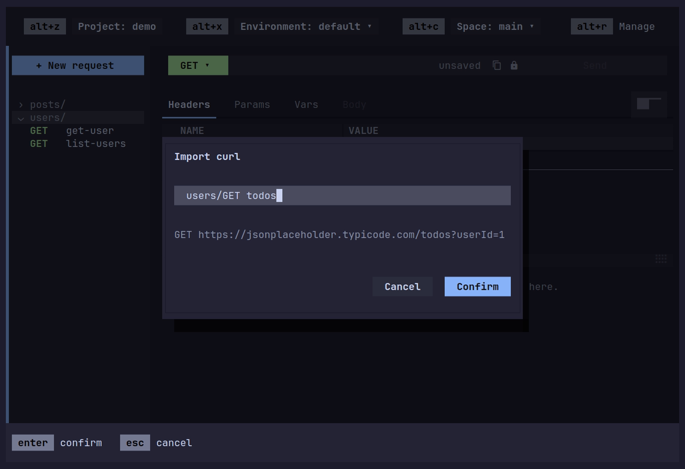
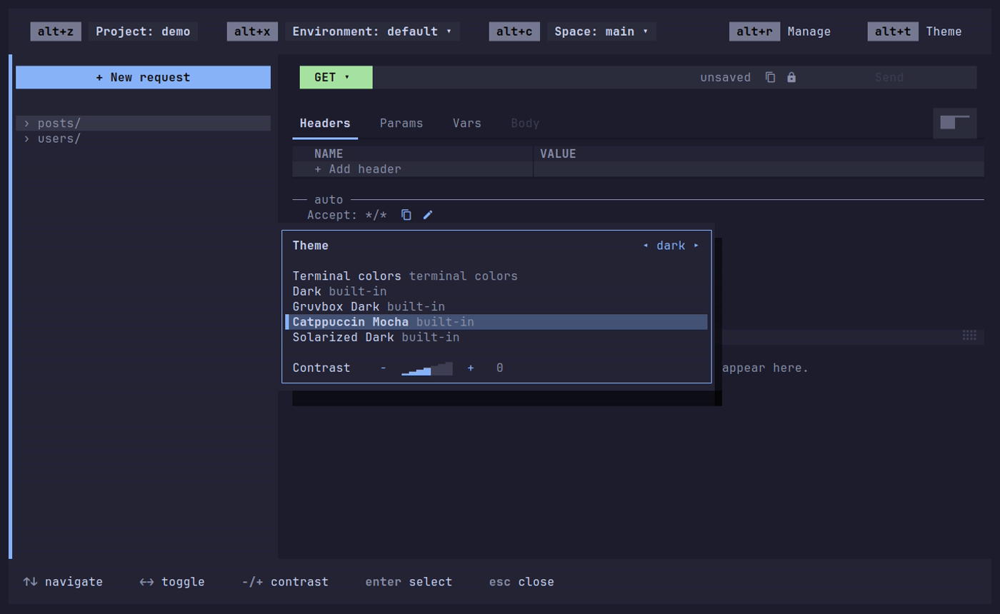
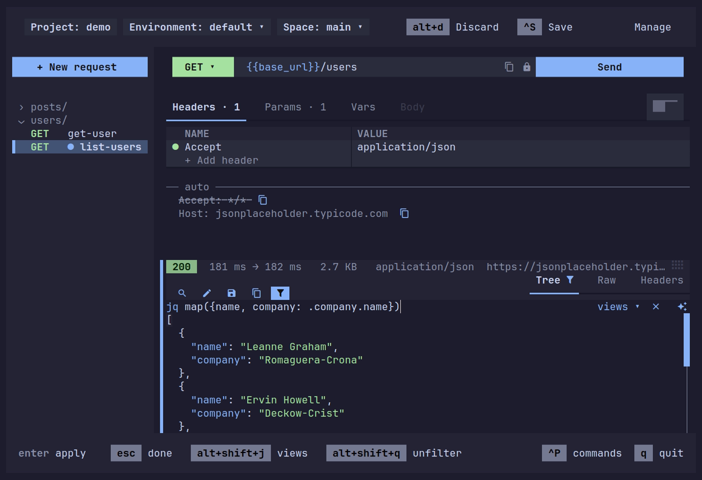

<h1 align="center">postui</h1>

<p align="center">
  A terminal HTTP client where everything works by mouse or by keyboard.<br>
  Requests are plain TOML files in your project, so they diff cleanly and live in git.
</p>

<p align="center">
  <a href="#install">Install</a> ·
  <a href="docs/guide.md">Guide</a> ·
  <a href="docs/configuration.md">Configuration</a> ·
  <a href="CHANGELOG.md">Changelog</a>
</p>

<p align="center">
  
</p>

## Features

- **Mouse or keyboard, all the way.** Every button, tab, menu and pane divider
  responds to the mouse, and every action also has a key: an arrows-and-Enter
  profile or a Vim profile, your pick on first launch. The footer always shows
  the keys for what has focus, and `ctrl+p` searches every command.
- **Requests are files.** One TOML file per request, in folders, grouped into
  spaces. Review them in a diff and commit them next to the code they test.
- **Environments, variables and secrets.** `{{tokens}}` in the URL, params and
  headers (and the body, once you switch that on) take their values from the
  active environment. Secrets stay in the project's git-ignored `.local/`
  folder, never in a committed file.
- **jq on every response.** Filter JSON live as you type, with completion for
  the keys the response really has. Save filters as named views, right-click
  the tree for filters written for you, or describe the one you want and let an
  AI command write it from the response's shape, never its values.
- **curl in and out.** Paste a curl command into the sidebar to import it as a
  request, or copy any request as curl.
- **Undo for everything.** Edits, deletes, renames and moves all undo, even
  after you've moved on to another request.
- **Themes.** Built-in dark and light themes, your terminal's own colors, a
  contrast control, and custom themes from six colors.

| | |
|:---:|:---:|
|  |  |
|  |  |

## Requests are plain files

A project is a folder. Put it in its own repo, or next to the code it tests:

```
my-api/
├── project.toml
├── variables.toml        # the variables requests use
├── environments/
│   ├── default.toml      # base_url = "https://api.example.com"
│   └── local.toml        # base_url = "http://localhost:3000"
├── requests/
│   └── main/             # a space
│       └── users/
│           └── list-users.toml
├── .gitignore            # /.local/ (postui writes it when it creates a project)
└── .local/               # yours alone, git-ignored: secrets, open tabs, layout
```

`requests/main/users/list-users.toml`:

```toml
method = "GET"
url = "{{base_url}}/users"

[params]
_limit = "5"

[headers]
Accept = "application/json"
```

## Install

**Homebrew** (macOS and Linux) is the recommended way:

```sh
brew install chawkinsuf/postui/postui
```

Or use the **shell installer**, which puts `postui` in `~/.local/bin`:

```sh
curl --proto '=https' --tlsv1.2 -LsSf https://github.com/chawkinsuf/postui/releases/latest/download/postui-installer.sh | sh
```

**Prebuilt binaries** for macOS (Apple Silicon and Intel) and Linux (x86_64 and
arm64, glibc 2.35 or newer) are on the
[releases page](https://github.com/chawkinsuf/postui/releases).

**From source**, with Rust 1.97 or newer:

```sh
cargo install --locked --git https://github.com/chawkinsuf/postui postui
```

postui's icons come from [Nerd Fonts](https://www.nerdfonts.com/): use a Nerd
Font, or a terminal with the symbols built in, such as Ghostty or WezTerm. On
Windows, run postui in [WSL 2](https://learn.microsoft.com/windows/wsl/install).

## Getting started

```sh
postui            # opens the last project, or a default one the first time
postui my-api     # opens the project in my-api, or offers to create one there
```

The first launch asks which keys you want: arrows and Enter, or Vim. Change it
any time on the Settings tab of the Manage screen (`alt+r`). The
[guide](docs/guide.md) covers spaces, environments, variables, the jq bar and
curl. [Configuration](docs/configuration.md) covers settings, key bindings and
themes.

On macOS, keys shown here as `alt+` are `opt+`, and your terminal's
option-as-alt setting needs to be on for `opt+` letter keys to reach postui.
`postui --setup` prints how to turn it on in your terminal.

## License

[MIT](LICENSE)
