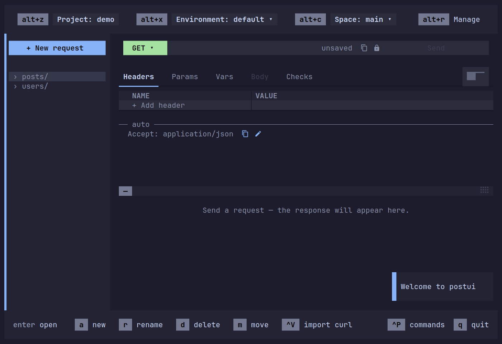
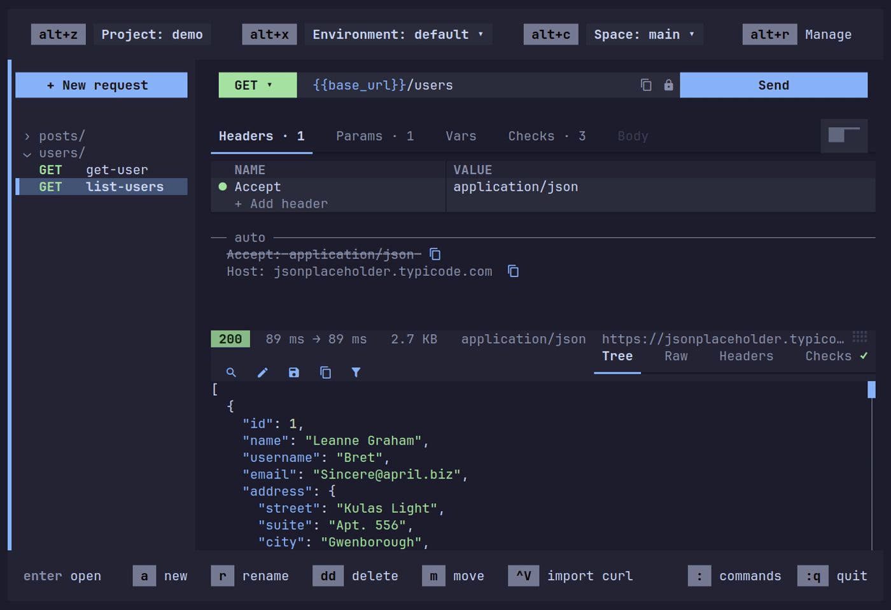
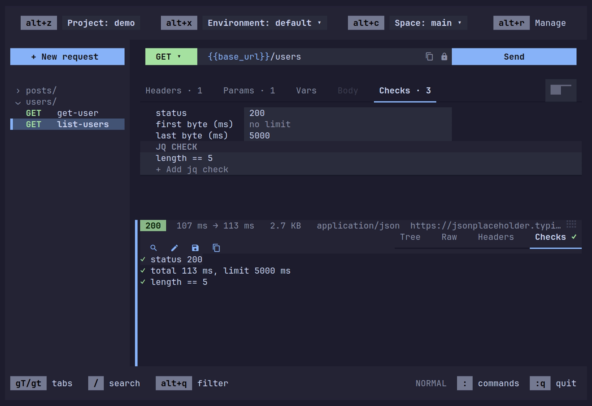
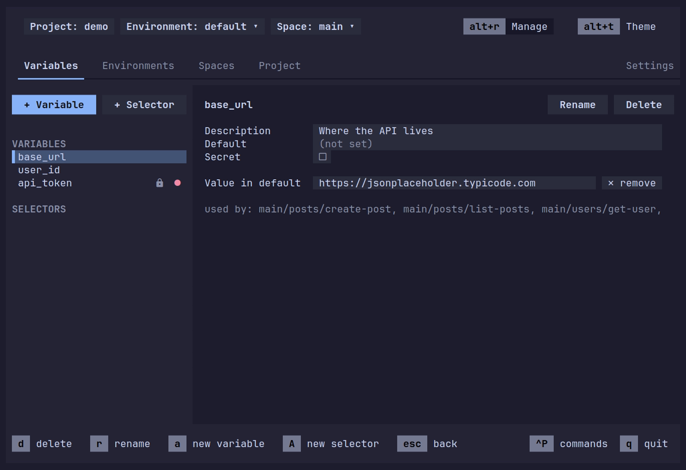
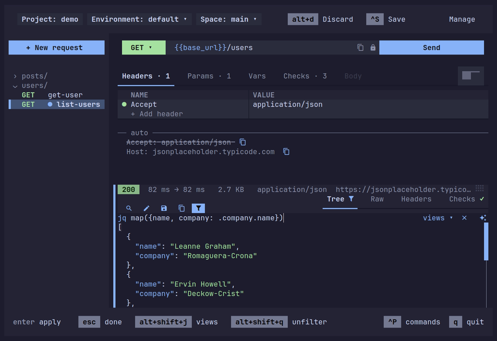
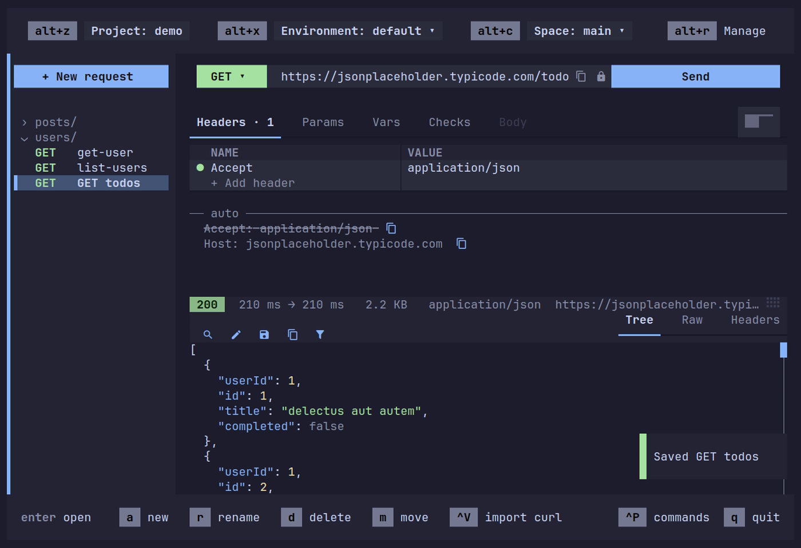
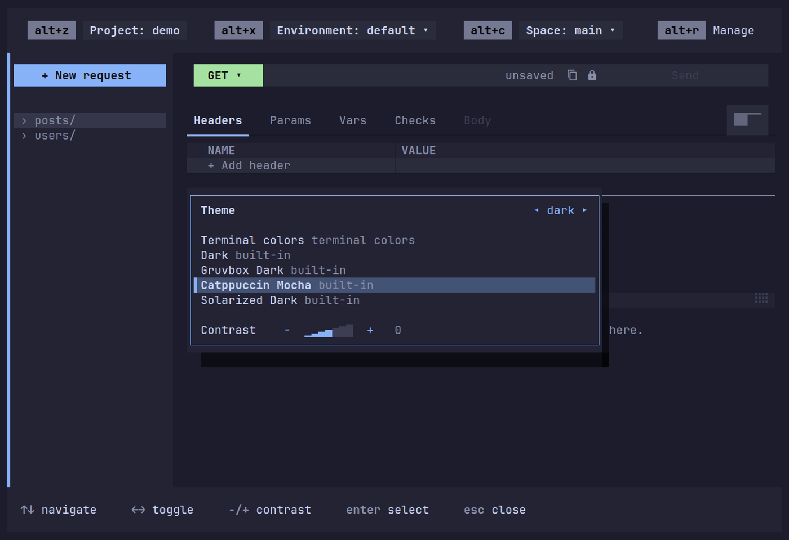

<h1 align="center">postui</h1>

<p align="center">
  A terminal HTTP client where everything works by mouse or by keyboard.<br>
  Requests are plain TOML files in your project, so they diff cleanly and live in git.
</p>

<p align="center">
  <a href="#install">Install</a> ·
  <a href="docs/guide.md">Guide</a> ·
  <a href="docs/configuration.md">Configuration</a> ·
  <a href="CHANGELOG.md">Changelog</a>
</p>

<p align="center">
  
</p>

## Features

- **Mouse or keyboard, all the way.** Every button, tab, menu and pane divider
  responds to the mouse, and every action also has a key: an arrows-and-Enter
  profile or a Vim profile, your pick on first launch. The footer always shows
  the keys for what has focus, and `ctrl+p` searches every command.
- **A real Vim mode.** If you use Vim, your muscle memory works: text objects,
  registers, `.`, Visual mode, search and folds in the response. The editing
  engine is tested against Vim 9.1.
- **Requests are files.** One TOML file per request, in folders, grouped into
  spaces. Review them in a diff and commit them next to the code they test.
  A folder keeps its name in a small `.folder.toml`, so even an empty one
  stays in git.
- **Environments, variables and secrets.** `{{tokens}}` in the URL, params and
  headers (and the body, once you switch that on) take their values from the
  active environment. Secrets stay in the project's `.postui/` folder, which
  postui keeps out of git with a `.gitignore` of its own.
- **jq on every response.** Filter JSON live as you type, with completion for
  the keys the response really has. Save filters as named views, right-click
  the tree for filters written for you, or describe the one you want and let an
  AI command write it from the response's shape, never its values.
- **Checks.** Say what a good response is: the statuses that pass (codes,
  ranges or comparisons), time limits, and jq filters that must give `true`. The app, `postui run` and
  the suite check each send against them.
- **curl in and out.** Paste a curl command into the sidebar to import it as a
  request, or copy any request as curl.
- **A command line for scripts and agents.** List a project's requests and
  variables, check it, and send one request or all of them, from a shell or
  a coding agent. At a terminal, the suite shows each request as it runs.
- **Undo for everything.** Edits, deletes, renames and moves all undo, even
  after you've moved on to another request.
- **Themes.** Built-in dark and light themes, your terminal's own colors, a
  contrast control, and custom themes from six colors.

## A closer look

**The Vim profile.** Folding the response, searching it and yanking a Visual
selection.

<a href="docs/guide.md#keys"></a>

**Checks.** The request's Checks tab says what a good response is, and the
response's shows how the last send did.

<a href="docs/guide.md#editing-a-request"></a>

**Variables and environments.** The Manage screen (`alt+r`) shows a variable's
description and its value in the active environment.

<a href="docs/guide.md#environments-variables-and-secrets"></a>

**Describe a filter.** An AI command writes the jq filter from the response's
shape, never its values.

<a href="docs/guide.md#the-jq-filter"></a>

**curl in.** Paste a curl command into the sidebar to import it as a request.

<a href="docs/guide.md#curl"></a>

**Themes.** Built-in dark and light themes, your terminal's own colors, and a
contrast control.

<a href="docs/configuration.md#themes"></a>

## Requests are plain files

A project is a folder. Put it in its own repo, or next to the code it tests:

```
my-api/
├── project.toml
├── variables.toml        # the variables requests use
├── environments/
│   ├── default.toml      # base_url = "https://api.example.com"
│   └── local.toml        # base_url = "http://localhost:3000"
├── requests/
│   └── main/             # a space
│       └── users/
│           └── list-users.toml
└── .postui/              # yours alone: secrets, open tabs, layout. Its own
                          # .gitignore keeps it out of git.
```

`requests/main/users/list-users.toml`:

```toml
method = "GET"
url = "{{base_url}}/users"

[params]
_limit = "5"

[headers]
Accept = "application/json"

[checks]
status = 200
max_elapsed_ms = 5000
jq = ['length == 5']
```

## Install

**Homebrew** (macOS and Linux) is the recommended way:

```sh
brew install chawkinsuf/tap/postui
```

Or use the **shell installer**, which puts `postui` in `~/.local/bin`:

```sh
curl --proto '=https' --tlsv1.2 -LsSf https://github.com/chawkinsuf/postui/releases/latest/download/postui-installer.sh | sh
```

**Prebuilt binaries** for macOS (Apple Silicon and Intel) and Linux (x86_64 and
arm64, glibc 2.35 or newer) are on the
[releases page](https://github.com/chawkinsuf/postui/releases).

**From source**, with Rust 1.97 or newer. This builds `main`, which can be
ahead of the latest release; add `--tag v<version>` for a release:

```sh
cargo install --locked --git https://github.com/chawkinsuf/postui postui
```

postui's icons come from [Nerd Fonts](https://www.nerdfonts.com/): use a Nerd
Font, or a terminal with the symbols built in, such as Ghostty or WezTerm. On
Windows, run postui in [WSL 2](https://learn.microsoft.com/windows/wsl/install).

## Getting started

```sh
postui            # opens the last project, or a default one the first time
postui my-api     # opens the project in my-api, or offers to create one there
postui --version  # prints the installed version
```

The first launch asks which keys you want: arrows and Enter, or Vim. Change it
any time on the Settings tab of the Manage screen (`alt+r`). The
[guide](docs/guide.md) covers spaces, environments, variables, the jq bar and
curl. [Configuration](docs/configuration.md) covers settings, key bindings and
themes.

On macOS, keys shown here as `alt+` are `opt+`, and your terminal's
option-as-alt setting needs to be on for `opt+` letter keys to reach postui.
`postui --setup` prints how to turn it on in your terminal.

## Command line

The same project works from the shell:

```sh
postui requests                          # the project's requests
postui run main/users/list-users         # send one and print the response
postui run main/users/list-users --jq '.[].name'
postui suite                             # send them all: status and timing
postui check                             # validate the files and variables
```

Run these in the folder that holds `project.toml`, or name the project with
`-p <dir|name>`. A request is named by its slug, as `postui requests` lists
it. Output is text; most commands print JSON with `--json`. `postui help`
lists every command and `postui help <command>` gives its usage.

### The suite

`postui suite` sends every request in the project, or in one space, and at a
terminal shows each one as it runs: a ✓ or ✗, its status, time and size, and
any check that failed. `-j 4` sends four at a time, and `-i` picks the
environment, space, selector options and jobs for one run without saving
them.

<a href="docs/guide.md#command-line"></a>

Without a terminal to draw on, or with `--plain`, the suite prints plain
text. It exits with status 1 when any request failed, so a script can act
on the result.

### For coding agents

postui comes with a [Claude Code](https://claude.com/claude-code) skill that
teaches an agent postui's commands and project files. With it, an agent
working on your API can send a request to check its change instead of
writing curl by hand, run the suite, and add or change requests, variables
and environments by editing the TOML.

```sh
postui skill install            # into ~/.claude/skills/postui
postui skill install --project  # into .claude/skills/postui in this folder
```

Skill files already there that differ are left alone; `--force` replaces
them, as after an upgrade. The agent marks its edits with `postui edit
begin` and `postui edit end`, and postui won't open the project while an
edit is in progress. The skill's source is in
[`skills/postui/`](skills/postui/SKILL.md).

## License

[MIT](LICENSE)
